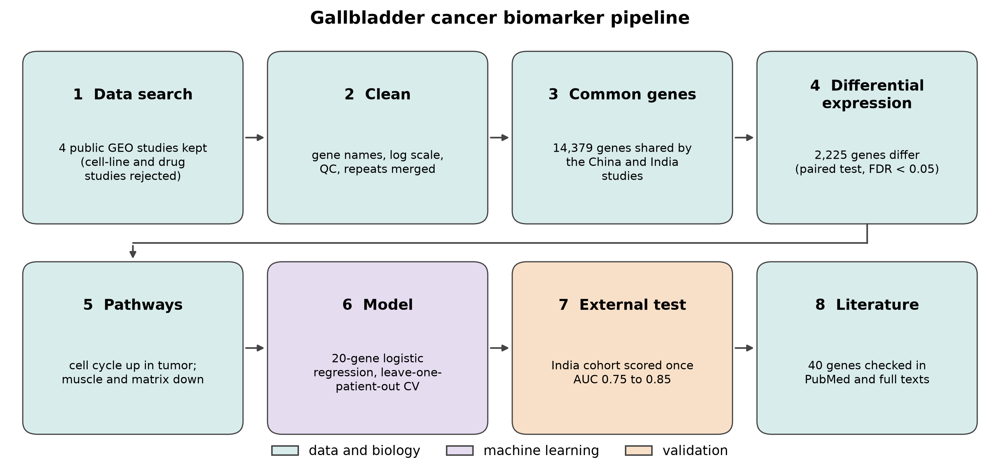
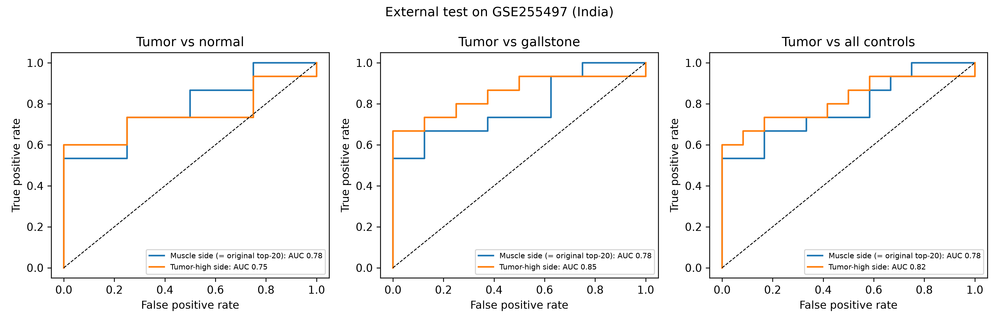

# Gallbladder cancer biomarker panel

A small gene panel that separates gallbladder tumour tissue from normal and gallstone tissue, trained on a Chinese cohort and tested once on an Indian cohort. Public GEO data, Python.



## Data

| Study | Country | Platform | Tumour | Normal | Gallstone | Role |
|---|---|---|---|---|---|---|
| GSE139682 | China | RNA-seq | 10 | 10 | - | training |
| GSE255497 | India | Agilent array | 15 | 4 | 8 | external test |
| GSE62335 | China | Affymetrix array | 5 | 5 | - | supplementary |
| GSE308395 | South Africa | RNA-seq | 7 | 2 | - | supplementary |

Files are downloaded by the code and cached in `data/raw`.

## Run

```
pip install -r requirements.txt
python run_all.py
```

Steps 4 and 6 need internet access to Enrichr and PubMed. Use `python run_all.py --skip 4 6` to leave them out.

## Results

| | |
|---|---|
| Genes tested (shared by both main studies) | 14,379 |
| Genes with FDR < 0.05, training study | 2,225 |
| Leave-one-patient-out AUC, 20-gene logistic regression | 0.98 |
| Shuffled-label test | p = 0.005 |

External test on GSE255497 (AUC, 95% CI):

| Panel | Tumour vs normal | Tumour vs gallstone | Tumour vs all controls |
|---|---|---|---|
| Muscle side | 0.78 (0.53-0.97) | 0.78 (0.57-0.94) | 0.78 (0.58-0.93) |
| Tumour-high side | 0.75 (0.50-0.95) | 0.85 (0.67-0.98) | 0.82 (0.64-0.96) |

GSE62335 and GSE308395 contained too few panel genes to be scored.



Cohorts are small and the results are exploratory. This is not a diagnostic test.

## Files

| File | Purpose |
|---|---|
| `01_download_and_clean.py` | download and clean the four studies |
| `02_harmonize.py` | shared genes, per-study standardization |
| `03_differential_expression.py` | paired test on the training study |
| `04_pathways.py` | pathway enrichment |
| `05_model_and_validation.py` | model, permutation test, external test |
| `06_gene_lookup_and_literature.py` | gene names and PubMed counts |
| `07_figures.py` | figures |
| `common.py` | settings and helpers |

## License

MIT
